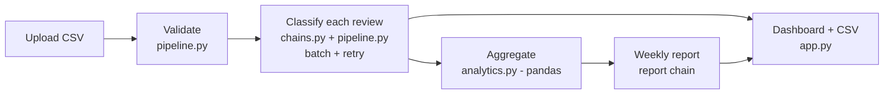

# ReviewLens - Artefacts Document

**Project:** ReviewLens - Customer Feedback Analyzer
**Programme:** Social Eagle - Final Assignments
**Document date:** 23 November 2026
**Purpose of this document:** to let anyone who has not seen the project understand **what** was built, **why**, **who** it is for, **where** everything lives, **when** the work happened and **how** it was made.

---

## 1. WHAT - what was built

**ReviewLens** is a small web application that turns a week of raw customer reviews into tagged, prioritised insights and a one-page report that a manager can act on in five minutes.

**Input:** a CSV file of reviews with the columns `review_id, date, platform, rating, review_text`. Reviews can be in English, Tamil, or Tanglish (Tamil written in English letters).

**Output:**

| Output | Description |
|---|---|
| Tagged reviews | Every review gets six fields: `sentiment` (positive / neutral / negative), `category` (food_quality, delivery, price, staff, packaging, app), `urgency` (low / medium / high), `language`, a one-line English `summary` and a polite `suggested_reply` |
| Weekly insights report | Top 3 complaints, top praises, the number of urgent reviews and 3 action items |
| Dashboard | Sentiment split, category chart and a switch to show only HIGH-urgency reviews |
| Enriched CSV | The original table plus the six new columns, opens correctly in Excel (including Tamil text) |

**Worked example** - input:
`R-1042, 2026-10-03, Swiggy, 1, "Ordered at 8pm, came at 9:10. Food fully cold. Very bad."`
becomes: *negative / delivery / high urgency / English / "Order arrived 70 minutes late and the food was cold." / a ready-to-post apology.*

### Artefact inventory (everything produced)

| # | Artefact | File | What it is |
|---|---|---|---|
| 1 | Web application | `app.py` | The Streamlit page: upload, progress, dashboard, report, downloads |
| 2 | Rulebook | `reviewlens/schema.py` | Allowed values and the typed answer forms (Pydantic) |
| 3 | AI chains | `reviewlens/chains.py` | Prompts + the LangChain pipelines for per-review analysis and the weekly report; the single place that selects the AI provider |
| 4 | Processing pipeline | `reviewlens/pipeline.py` | CSV validation, batched AI processing, automatic retries, Excel-safe export |
| 5 | Analytics and report | `reviewlens/analytics.py` | pandas counts and the report assembly |
| 6 | Sample data generator | `sample_data/generate_sample.py` | Creates the practice dataset |
| 7 | Sample dataset | `sample_data/reviews_week40.csv` | 240 rows (English, Tamil, Tanglish) including 4 deliberately broken rows |
| 8 | Automated tests | `tests/test_pipeline.py` | 12 tests using a fake AI (no key, no cost) |
| 9 | Program guide | `docs/ReviewLens_Program_Guide.md` | Plain-language explanation of every program, with diagrams |
| 10 | This document | `docs/ReviewLens_Artefacts.md` | What / Why / Who / Where / When / How |
| 11 | Setup files | `README.md`, `requirements.txt`, `.env.example` | Quick start, library list, template for the secret key |
| 12 | Original brief | `../Assignment Details.md` | The assignment specification this work answers |

---

## 2. WHY - why it was built

**The business problem.** A restaurant chain or online store receives 200-500 reviews a week from Google, Zomato, Swiggy and Amazon. Today a manager reads them by hand, which causes three failures:

1. **Urgent complaints are missed for days** - food poisoning, a wrong order, rude staff.
2. **Nobody can quantify** what customers complain about most.
3. **Tamil and Tanglish reviews** are hard to scan for anyone not reading them quickly.

**The learning objective.** The assignment is also a vehicle to practise modern LLM application techniques:

| Concept | Where it appears |
|---|---|
| Prompt templates and LCEL chains (`\|`) | `chains.py` |
| Structured output (Pydantic + `with_structured_output`) | `schema.py`, `chains.py` |
| Batching with controlled concurrency | `pipeline.py` (`chain.batch`, `max_concurrency`) |
| Map-then-reduce summarisation | per-review chain, then one report chain (`analytics.py`) |
| Swappable LLM provider | `get_llm()` - OpenAI or Anthropic via one setting |
| UI with Streamlit, pandas and a chart library | `app.py` (Plotly charts) |

**Key design decisions and the reasons behind them**

| Decision | Reason |
|---|---|
| All counts and percentages calculated in **pandas**, never by the AI | Language models are unreliable at arithmetic; this guarantees the report always matches the table |
| AI answers forced into a **typed form**; invalid ones are **retried**, then marked `needs review` | Guarantees every review has all six fields with allowed values, and failures are visible rather than silently wrong |
| **Two models**: a fast, cheap one for each review; a stronger one for the single weekly report | Cost and speed where volume is high, quality where it matters most |
| **Provider switch** in one function | The company can change AI vendor without touching the rest of the program |
| API key from a **`.env`** file; `.env` is git-ignored | The secret never appears in the source code or the repository |
| CSV saved as **UTF-8 with BOM** | Excel then shows Tamil text correctly |
| Review text treated as **data, not instructions** (prompt-injection guard) | A review reading "ignore your rules" must not change the AI's behaviour |

---

## 3. WHO - who it is for and who is involved

| Role | Involvement |
|---|---|
| **Operations manager** | Primary user: reads the weekly report and the dashboard; decides on action items |
| **Customer support team** | Works from the enriched CSV in Excel; posts the suggested replies, starting with HIGH-urgency reviews |
| **Business owner** | Reads the headline numbers and the top complaints/praises |
| **Assignment author** | Designed and delivered the project as the Social Eagle final assignment |
| **AI assistant (Claude Code)** | Used as a pair-programming tool to write the code, comments, tests and documents under the author's direction |

---

## 4. WHERE - where everything lives and runs

| Item | Location |
|---|---|
| Project folder | `D:\Users\SAI\Social Eagle\Final Assignments\ReviewLens\ReviewLens_CFA` |
| Assignment brief | `D:\Users\SAI\Social Eagle\Final Assignments\ReviewLens\Assignment Details.md` |
| Source control | Local git repository on branch `main` |
| Documents | `ReviewLens_CFA\docs\` |
| Runs on | A local machine (Windows 11, Python 3.13); the app opens in a web browser at `localhost` |
| External services | OpenAI API (default) or Anthropic API, called over the internet using the user's own key |
| Secrets | Held only in a local `.env` file, which is excluded from git |
| Data privacy | Reviews are sent to the chosen AI provider for analysis; nothing else leaves the machine |

**Technology stack:** Python 3.13, Streamlit, pandas, Plotly, Pydantic, LangChain (`langchain-core`, `langchain-openai`, `langchain-anthropic`), python-dotenv, pytest.

---

## 5. WHEN - timeline and status

| When | What happened |
|---|---|
| 16 Nov 2026 | Assignment brief read; plan agreed (stack, structure, provider) |
| 16 Nov 2026 | Application built: schema, chains, pipeline, analytics, Streamlit UI, sample data, tests |
| 16 Nov 2026 | Provider changed from Anthropic Claude to **OpenAI** (the only API key available) with a one-setting option to use Claude |
| 16 Nov 2026 | Layman-level comments added to every program; Program Guide and this Artefacts document written |
| 20 Nov 2026 | Live run against OpenAI; all three stretch goals built; language-label fix added (see below) |
| 23 Nov 2026 | Second sample (week 41) added; manual checks done; real e-mail sent; Monday 09:00 Windows scheduled task created and test-run |

**Status at the time of writing (23 Nov 2026)**

| Check | Result |
|---|---|
| Automated tests (12) | Pass |
| App loads in Streamlit's test harness | No errors |
| Live run, OpenAI (`gpt-4o-mini` + `gpt-4o`), two 240-row files (236 valid rows each) | Completed in ~100 s each; **0 reviews ended as "needs review"** |
| Tamil / Tanglish | Tamil summaries read correctly in English; replies come back in Tamil script (Tamil) or Latin letters (Tanglish) |
| HIGH-urgency tagging | Food poisoning, wrong order, payment-taken-but-failed and 1h+ late deliveries were tagged HIGH |
| Monday e-mail | Unit-tested, and a **real send through Gmail SMTP succeeded** (e-mail received with the CSV attached). The Windows scheduled task "ReviewLens Weekly Report" (Mondays 09:00, runs missed starts) was created and a manual run returned result 0 |
| HIGH filter, Excel CSV, trend arrows, prompt-injection review | All verified manually by the author: filter shows only HIGH rows, Tamil displays correctly in Excel, week-41 upload shows trend arrows against week 40, and the injection review was not marked positive |

**Defect found by the live run and fixed:** the AI sometimes labelled Tanglish (Latin-letter) reviews as "Tamil", so they
received Tamil-script replies. The program now detects the writing system itself, passes it to the AI as a hint, and
overrules a wrong "Tamil" label. After the fix, every Tamil-script review was labelled Tamil and every Tanglish review
got a Latin-letter reply. One Tanglish praise review still received an English reply (model choice; harmless).

**Stretch goals - all built:** (1) week-over-week trend arrows (history folder or uploaded previous CSV);
(2) replies in the reviewer's own language (`REVIEWLENS_REPLY_LANGUAGE`); (3) automatic Monday e-mail
(`send_weekly_report.py` + Windows Task Scheduler command in the README).

---

## 6. HOW - how it was made and how to use it

### 6.1 Architecture



1. **Validate** - check the five columns; drop empty, duplicate and bad-date rows.
2. **Classify (map)** - a LangChain chain (`prompt | model | structured output`) tags each review; `chain.batch` runs groups of 25 with limited concurrency; any invalid or failed answer is re-asked up to 2 times, then marked `needs review`.
3. **Aggregate** - pandas counts sentiment, category, urgency and platform.
4. **Report (reduce)** - the report chain receives the exact numbers plus one-line summaries and returns themes and 3 action items; counts beside each theme come from pandas.
5. **Show and export** - Streamlit dashboard with a HIGH-urgency filter; Excel-ready CSV download.

### 6.2 How it was built (method)

1. Read the brief and extracted requirements and the "Done checklist".
2. Designed the structure so each file has one job (rules / AI / processing / maths / screen).
3. Wrote the code, then **tested without the AI** using a stub, so logic could be verified cheaply and repeatably.
4. Added plain-language comments to every program, then the guide with diagrams.
5. Reviewed the work against the Done checklist (below).

### 6.3 How to run it

```powershell
cd "D:\Users\SAI\Social Eagle\Final Assignments\ReviewLens\ReviewLens_CFA"
python -m venv .venv
.venv\Scripts\activate
pip install -r requirements.txt
copy .env.example .env          # open .env and paste your OPENAI_API_KEY
streamlit run app.py            # then upload sample_data\reviews_week40.csv
python -m pytest -q             # optional: run the automatic tests
```

To use Claude instead, set `REVIEWLENS_PROVIDER=anthropic` and `ANTHROPIC_API_KEY` in `.env`.

### 6.4 Done checklist - evidence

| Requirement from the brief | Evidence | Status |
|---|---|---|
| Processes a 200+ row CSV without crashing or timing out | 240-row sample; batching, concurrency cap, timeouts, per-review error isolation | Verified live: 236 rows, no failures |
| Every review has all 6 fields from the allowed list | Pydantic `Literal` types, `_is_valid` check, retry, `needs review` fallback; test `test_retry_then_success_and_needs_review` | Verified in tests |
| Tamil and Tanglish reviews get a correct English summary | Prompt rule + Tamil and Tanglish rows in the sample | Verified live (Tamil and Tanglish) |
| Report numbers exactly match the table (pandas, not LLM) | `compute_stats`; test `test_stats_and_report_numbers_from_pandas` | Verified in tests |
| HIGH urgency filter works; CSV opens correctly in Excel | Dashboard toggle; BOM test `test_csv_export_has_bom` | Export verified (BOM). Filter: UI built, confirm visually |
| API key from `.env`, never hard-coded | `load_dotenv()` + `os.getenv`; `.env` git-ignored | Verified by code review |

### 6.5 Known limits and honest notes

- Theme counts in the report equal the number of negative (or positive) reviews in the theme's **category**, not the number of reviews matching the theme's wording. This keeps numbers exact but is coarser than a per-theme count.
- Even at temperature 0 the AI is not perfectly repeatable: two runs of the same file differed by a few HIGH-urgency tags (e.g. 17 vs 18 in the week-over-week change).
- Trend arrows need an earlier week: either analyse it first (saved in `history/`) or upload its enriched CSV.
- AI output quality depends on the model and prompt; a human should skim the first run's Tamil/Tanglish summaries.
- A review is sent to an external AI provider; do not upload data you are not permitted to share with that provider.
- The default OpenAI model names (`gpt-4o-mini`, `gpt-4o`) can be changed in `.env` if the account uses different models.
