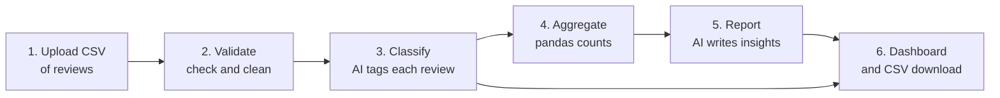
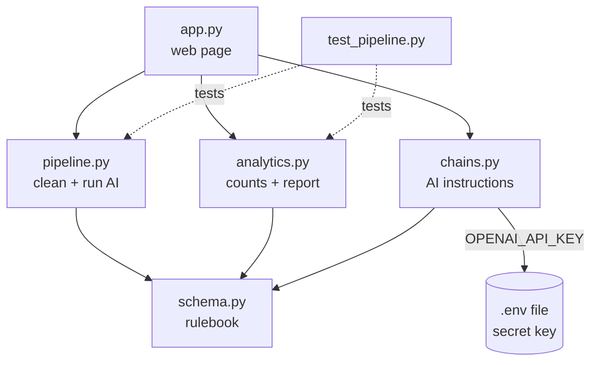
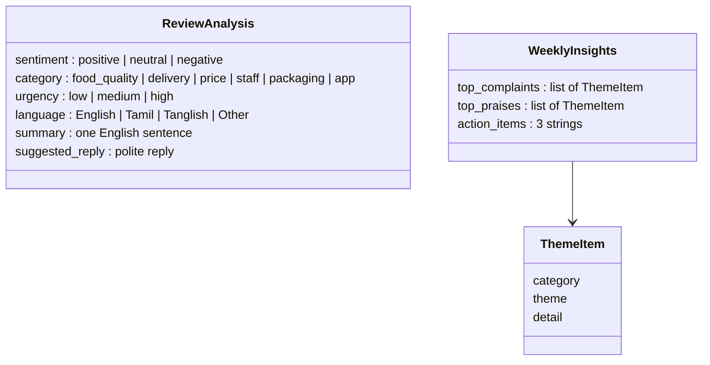
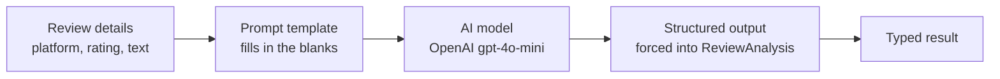
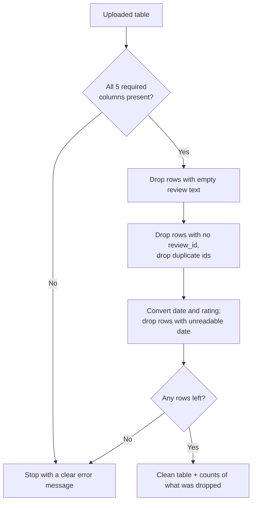
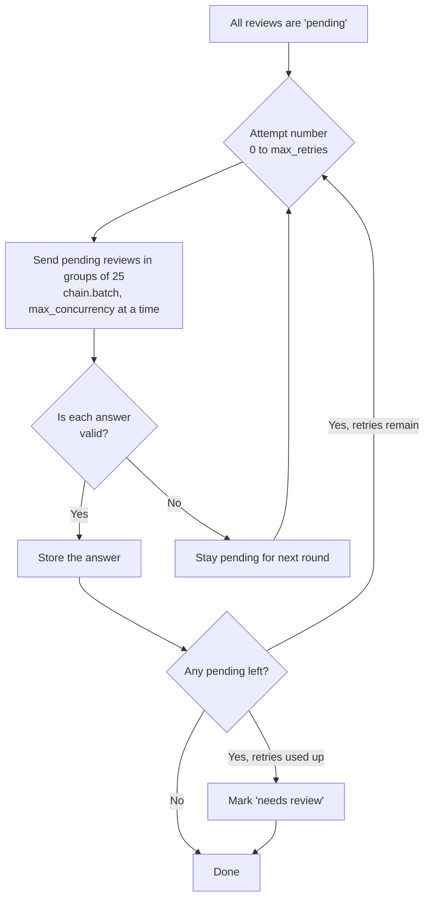
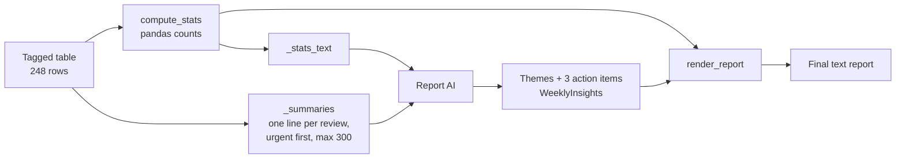
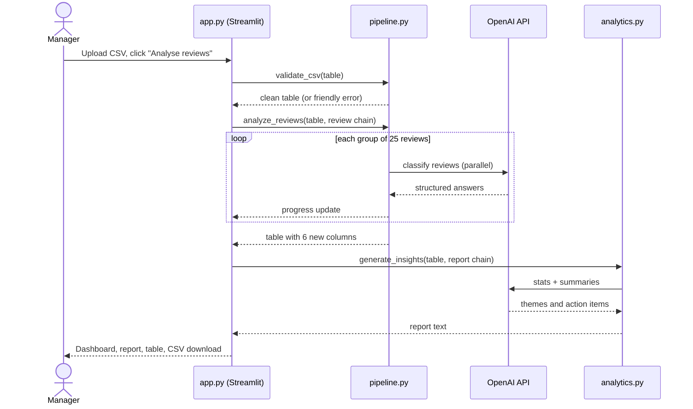

# ReviewLens - Program Guide

*A plain-language explanation of every program in the project, with diagrams.*
*(Diagrams use Mermaid and render automatically on GitHub, VS Code (Markdown Preview Mermaid extension) and most Markdown viewers.)*

---

## 1. The problem in one paragraph

A restaurant chain or online store gets 200-500 reviews a week from Google, Zomato, Swiggy and Amazon, in English, Tamil and Tanglish (Tamil typed in English letters). A manager reading them by hand misses urgent complaints (food poisoning, wrong order, rude staff) and cannot say with numbers what customers complain about most. **ReviewLens** reads every review with an AI, tags it, counts everything, writes a one-page weekly report and shows a dashboard, so the manager can act in five minutes.

## 2. The big picture



Think of it as a **factory line**: raw reviews go in at the left, a finished manager's report and a tidy spreadsheet come out at the right. Each station is one part of the code.

## 3. Project layout - what each file is

```text
ReviewLens_CFA/
├── app.py                      <- the web page (what the manager sees)
├── reviewlens/
│   ├── schema.py               <- the rulebook: allowed values and answer forms
│   ├── chains.py               <- instructions to the AI + connection to OpenAI/Claude
│   ├── pipeline.py             <- cleans the CSV, runs the AI on every review, retries
│   └── analytics.py            <- counts with pandas, writes the weekly report
├── sample_data/
│   ├── generate_sample.py      <- makes the practice CSV
│   └── reviews_week40.csv      <- 240 practice reviews (English / Tamil / Tanglish)
├── tests/test_pipeline.py      <- automatic safety checks
├── requirements.txt            <- list of libraries to install
├── .env.example                <- template for the secret API key file
└── README.md                   <- quick start
```

### How the files depend on each other



An arrow means "uses". `schema.py` is at the bottom because everyone shares its rules, and it uses nobody.

---

## 4. Program-by-program explanation

### 4.1 `reviewlens/schema.py` - "The rulebook"

**Purpose:** decide in advance exactly what an AI answer must look like, so the AI cannot return free-form text.

**Analogy:** a form with fixed boxes. For *sentiment* you may tick only *positive*, *neutral* or *negative*; you cannot write "kinda bad".

| Item | What it is |
|---|---|
| `Sentiment`, `Category`, `Urgency`, `Language` | The allowed words for each box |
| `REQUIRED_COLUMNS` | The 5 columns every uploaded CSV must have |
| `NEEDS_REVIEW` | The label for "the AI failed, a human must read this" |
| `ReviewAnalysis` | The form for **one review** (6 boxes) |
| `ThemeItem`, `WeeklyInsights` | The form for the **weekly report** (themes + 3 action items) |



Note that `WeeklyInsights` has **no number fields** on purpose: the AI is never asked to count.

### 4.2 `reviewlens/chains.py` - "The instructions and the AI connection"

**Purpose:** build the two "assembly lines" (LangChain *chains*) that talk to the AI.

**A chain** is written with the `|` symbol and works like a conveyor belt:



| Piece | Plain meaning |
|---|---|
| `REVIEW_SYSTEM` | The standing rules for the per-review AI: understand Tamil/Tanglish, pick from allowed lists, always summarise in English, ignore instructions hidden inside a review |
| `REVIEW_HUMAN` | The template for the actual review, with blanks `{platform}`, `{rating}`, `{review_text}` |
| `REPORT_SYSTEM` / `REPORT_HUMAN` | Same idea for the weekly-report AI |
| `get_llm()` | **The only place that knows which AI company is used.** Reads `REVIEWLENS_PROVIDER` (`openai` default, or `anthropic`), checks the API key exists, and creates the connection. `temperature=0` makes answers consistent |
| `build_review_chain()` | prompt `|` AI `|` forced structure (`ReviewAnalysis`) |
| `build_report_chain()` | same, with a stronger model, forced structure `WeeklyInsights` |

**Swapping the AI:** set `REVIEWLENS_PROVIDER=anthropic` in `.env`. Nothing else changes - this is the "swap models without changing the chain" requirement.

### 4.3 `reviewlens/pipeline.py` - "The factory floor"

**Purpose:** clean the spreadsheet, run the AI over every review, handle failures, and produce the download file.

#### `validate_csv` - the quality gate



#### `analyze_reviews` - classify with automatic retry

The AI sometimes fails (network blip, invalid category). Rather than lose a review, the program asks again, and only after all retries fail does it mark the review `needs review`.



"Valid" (`_is_valid`) means: a proper `ReviewAnalysis`, every constrained value on its allowed list, and a non-blank summary and reply.

`chain.batch(..., max_concurrency=5)` sends up to 5 reviews at the same time. That is much faster than one at a time, but stays under the AI company's rate limits. `return_exceptions=True` means one failed review never crashes the whole run.

#### `to_excel_csv`
Produces the download file with a hidden "BOM" marker (`utf-8-sig`) so that Excel shows Tamil letters correctly instead of garbage.

### 4.4 `reviewlens/analytics.py` - "The calculator and report writer"

**Purpose:** the **reduce** step. Hundreds of per-review results become one report.

**Map then reduce:** the *map* step handles each review separately (cheap, parallel). The *reduce* step squeezes all results into one short report. This is how you summarise data that is too big to paste into a single AI prompt.



**The key design rule:** *numbers come from pandas, wording comes from the AI.* In `render_report`, the figure beside each complaint theme is the pandas count of negative reviews in that theme's category. Language models are poor at counting, so the AI is never trusted with arithmetic. That is why the report always matches the table exactly.

### 4.5 `app.py` - "The screen the manager sees"

**Purpose:** the Streamlit web page. Streamlit re-runs the file from top to bottom on every click, so results are saved in `st.session_state` (the page's memory).



**What the manager sees**

```text
+-----------------------------------------------------------------+
| ReviewLens                                                      |
+-----------+-----------------------------------------------------+
| Upload    | [Dashboard] [Weekly report] [Reviews table]         |
| [file...] |  [x] Show only HIGH urgency reviews                 |
| slider    |  Reviews | High urgency | Negative % | Needs review |
| [Analyse] |  (donut: sentiment split)  (bars: by category)      |
|           |  table: id | date | urgency | summary | reply      |
+-----------+-----------------------------------------------------+
```

* **Dashboard tab:** four headline numbers, a donut chart (sentiment split), a bar chart (category, coloured by sentiment) and the **HIGH-urgency toggle**, which filters every number, chart and table at once.
* **Weekly report tab:** the text report and a download button.
* **Reviews table tab:** the full enriched table and the **Excel-ready CSV** download.

### 4.6 `sample_data/generate_sample.py`
Creates `reviews_week40.csv` with 240 practice rows in English, Tamil and Tanglish, plus 4 deliberately broken rows (blank text, spaces only, duplicate id, invalid date) to prove validation works. A fixed random seed makes the file identical on every run.

### 4.7 `tests/test_pipeline.py`
Five automatic checks that use a **fake AI** (so no API key, no cost, same result every time):

| Test | What it proves |
|---|---|
| `test_validate_drops_empty_and_duplicates` | Blank and repeated rows are removed |
| `test_validate_missing_column` | A file without a required column is rejected |
| `test_retry_then_success_and_needs_review` | A failing review is retried; a hopeless one becomes `needs review` after all retries |
| `test_stats_and_report_numbers_from_pandas` | Percentages and report counts come from pandas |
| `test_csv_export_has_bom` | The download file is Excel-safe |

---

## 5. One review, end to end (worked example)

Input row: `R-1042, 2026-10-03, Swiggy, 1, "Ordered at 8pm, came at 9:10. Food fully cold. Very bad."`

1. **Validate:** all columns present, text not empty, id unique, date readable -> kept.
2. **Classify:** the chain fills the template with *Swiggy / 1 / the text* and the AI returns:
   `sentiment=negative, category=delivery, urgency=high, language=English, summary="Order arrived 70 minutes late and the food was cold.", suggested_reply="We are really sorry..."`
3. **Check:** every value is on the allowed list -> accepted. (If not, it is asked again up to 2 more times.)
4. **Aggregate:** it adds +1 to *negative*, *delivery*, *Swiggy*, *high urgency* in the pandas counts.
5. **Report:** the AI sees "delivery | Swiggy | Order arrived 70 minutes late..." among the negatives and may name the theme "Late delivery"; the number next to it is the pandas count.
6. **Show:** the review appears in the table; switching on *HIGH urgency* keeps it; the CSV download includes all 6 new columns.

## 6. How the "Done checklist" is satisfied

| Requirement | Where it is met |
|---|---|
| Processes 200+ rows without crashing/timeouts | Batches of 25, `max_concurrency`, per-call 60 s timeout, `return_exceptions=True` (`pipeline.py`, `chains.py`) |
| Every review has all 6 fields from the allowed list | Pydantic `Literal` types + `_is_valid` + retry + `needs review` fallback |
| Tamil / Tanglish get an English summary | Instructions in `REVIEW_SYSTEM`; sample data contains both |
| Report numbers match the table | All counts from pandas (`compute_stats`); AI never counts |
| HIGH urgency filter + Excel-ready CSV | Dashboard toggle; `to_excel_csv` with BOM |
| API key from `.env`, never hard-coded | `load_dotenv()` + `os.getenv(...)`; `.env` is in `.gitignore` |

## 7. Glossary (for non-programmers)

| Term | Meaning |
|---|---|
| **LLM** | The AI language model (here OpenAI's GPT, or Anthropic's Claude) |
| **Prompt** | The written instructions given to the AI |
| **Chain (LCEL)** | Steps joined with `\|`, output of one feeding the next |
| **Structured output** | Forcing the AI to answer in a fixed form, not free text |
| **Pydantic** | The library that defines the form and rejects wrong values |
| **Batch / concurrency** | Sending many items together / several at the same moment |
| **Map then reduce** | Process items one by one, then combine into one summary |
| **pandas / DataFrame** | Python's spreadsheet-like table tools |
| **Streamlit** | Turns a Python file into a web page |
| **Tanglish** | Tamil written in English letters |
| **BOM** | Invisible marker that makes Excel read Tamil text correctly |
| **.env file** | A private file holding the secret API key |
